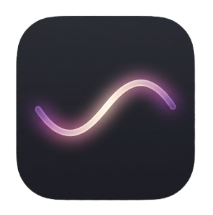

# LifeOS — All-in-One Personal Life Management Mobile App

<p align="center">
  
</p>

<p align="center">
  <strong>An offline-first, AI-powered personal operating system for mobile — seamlessly integrating financial management, daily planning, health tracking, and multimodal AI assistance.</strong>
</p>

<p align="center">
  <a href="https://reactnative.dev"></a>
  <a href="https://expo.dev"></a>
  <a href="https://www.typescriptlang.org"></a>
  <a href="https://sqlite.org"></a>
  <a href="https://openai.com"></a>
  <a href="LICENSE"></a>
</p>

---

## 📌 Problem & Motivation

Modern smartphone users frequently juggle between 4 to 5 disparate applications to organize their day: one for expense tracking, another for to-do checklists, a separate app for calorie counting, and an AI chat app for advice. This causes severe context switching, fragmented personal data, and frequent reliance on internet connections or cloud subscriptions.

**LifeOS** resolves this fragmentation by unifying your personal life into a single, high-performance, **100% offline-first application**. Your sensitive financial and personal logs never leave your device SQLite database, while an intelligent AI companion assists you via text, voice, and vision.

---

## ✨ Key Features

### 🤖 1. Multimodal AI Assistant (Text, Voice, Vision)
- **Natural Language Parsing**: Automatically converts conversational prompts into database entries (e.g., *"Spent 50,000 UZS on lunch"* immediately creates a financial expense; *"Meeting tomorrow at 3 PM"* creates a task).
- **Voice-to-Action**: Transcribe voice memos directly into structured entries via OpenAI Whisper.
- **Computer Vision (Food & Calorie Estimation)**: Upload or capture food photos to automatically analyze meal contents, portion estimates, and calculate consumed calories.
- **Context-Aware Recommendations**: Offers smart schedule suggestions based on pending tasks and user goals.

### 💰 2. Personal Finance & Debt Management
- **ACID Transaction Support**: Robust local SQLite schema with explicit `BEGIN TRANSACTION / COMMIT / ROLLBACK` integrity.
- **Multi-Currency Tracking**: Native support for **UZS** and **USD** with real-time conversion rates.
- **Debt Tracking**: Categorize debts as borrowed or lent with repayment reminders and automatic balance synchronization.
- **Privacy Mode (Eye Toggle)**: One-tap toggle to mask balance and numbers (`••••••`) in public spaces.

### 📅 3. Smart Day Planner
- **Interactive Calendar Navigation**: Navigate through days with date navigation strips.
- **Priority Categorization**: Color-coded priorities (High, Medium, Low) and categories (Work, Personal, Fitness, Study).
- **AI Daily Plan Suggestion**: Generates optimized daily time-blocks on demand.

### 🍎 4. Health & Wellness Logger
- **Calorie Tracker**: Daily calorie intake counter with progress bars against personalized targets.
- **Wellness Metrics**: Track sleep duration, water intake (liters), workout minutes, and physical weight over time.
- **Conflict-Resilient Logs**: SQLite `ON CONFLICT DO UPDATE` upsert logic to ensure daily logs stay consistent.

### 🔐 5. Security & Biometrics
- **Hardware-Backed Biometrics**: Fingerprint and Face ID authentication via `expo-local-authentication`.
- **4-Digit PIN Lock**: Custom PIN security keypad with haptic feedback vibration on incorrect inputs.
- **Hardware Keystore Protection**: Sensitive keys (such as OpenAI API credentials) are stored via `expo-secure-store` in Android Keystore / iOS Keychain, never in raw plaintext.

### 🌐 6. Offline-First & Bilingual
- **Zero Cloud Dependence for Core Features**: Works completely without internet connection.
- **Bilingual Interface**: Full localization in **Uzbek (O'zbekcha)** and **English**.

---

## 🏗 System Architecture & Directory Structure

```
LifeOS/
├── app/                          # Expo Router (File-based Routing)
│   ├── (tabs)/                   # Bottom Tab Navigator
│   │   ├── index.tsx             # Home Dashboard (Balance summary, quick stats)
│   │   ├── finance.tsx           # Cash flow breakdown, income/expense, debts
│   │   ├── planner.tsx           # Daily task manager, date nav, AI planning
│   │   ├── health.tsx            # Calorie progress, food history, wellness stats
│   │   └── ai.tsx                # AI Assistant (Chat, voice transcription, vision)
│   ├── _layout.tsx               # Root layout, DB initialization, PIN lock gate
│   ├── pin-lock.tsx              # Biometric & PIN authentication screen
│   ├── add-transaction.tsx       # New income/expense modal
│   ├── add-task.tsx              # Task creation modal
│   ├── add-debt.tsx              # Debt management modal
│   ├── add-food.tsx              # Food & calorie logger modal
│   ├── edit-balance.tsx          # Manual balance adjustments
│   └── settings.tsx              # App preferences, language, API keys, PIN setup
├── src/
│   ├── constants/
│   │   └── theme.ts              # Design tokens (Colors, Typography, Spacing, Radii)
│   ├── database/
│   │   ├── init.ts               # SQLite schema definition & migrations
│   │   ├── queries.ts            # Finance, balance, debts, settings CRUD
│   │   └── healthQueries.ts      # Tasks, food logs, wellness metrics CRUD
│   ├── i18n/
│   │   └── translations.ts       # Uzbek & English dictionary strings
│   ├── services/
│   │   ├── openai.ts             # GPT-4o-mini, Whisper, and Vision integrations
│   │   └── notifications.ts      # Local scheduled push notifications
│   ├── store/
│   │   └── useAppStore.ts        # Zustand global state manager
│   └── types/
│       └── index.ts              # TypeScript interfaces and entity types
├── assets/                       # Custom adaptive icons, splash screens, avatar
├── app.json                      # Expo application manifest & native permissions
└── eas.json                      # Expo Application Services build configurations
```

---

## 🛠 Tech Stack

| Domain | Technology |
|---|---|
| **Framework** | [React Native 0.86](https://reactnative.dev/) with [Expo SDK 57](https://expo.dev/) |
| **Language** | [TypeScript](https://www.typescriptlang.org/) (Strict typing throughout) |
| **Navigation** | [Expo Router](https://docs.expo.dev/router/introduction/) (File-based routing) |
| **Local Database** | [expo-sqlite](https://docs.expo.dev/versions/latest/sdk/sqlite/) (ACID, local file persistence) |
| **State Management** | [Zustand](https://github.com/pmndrs/zustand) |
| **Security** | [expo-local-authentication](https://docs.expo.dev/versions/latest/sdk/local-authentication/) & [expo-secure-store](https://docs.expo.dev/versions/latest/sdk/securestore/) |
| **AI & Multimodal** | OpenAI API (`gpt-4o-mini`, `whisper-1`) |
| **Media & Audio** | [expo-av](https://docs.expo.dev/versions/latest/sdk/av/) & [expo-image-picker](https://docs.expo.dev/versions/latest/sdk/image-picker/) |
| **Date Utilities** | [date-fns](https://date-fns.org/) |
| **Build & Deploy** | [EAS (Expo Application Services)](https://expo.dev/eas) |

---

## 🚀 Getting Started

### Prerequisites
- Node.js (v18 or higher)
- npm or yarn
- Expo Go app on your physical device OR Android Studio / Xcode emulator

### Installation

1. **Clone the repository:**
   ```bash
   git clone https://github.com/cohurricane-create/LifeOS.git
   cd LifeOS
   ```

2. **Install dependencies:**
   ```bash
   npm install --legacy-peer-deps
   ```

3. **Start the development server:**
   ```bash
   npx expo start -c
   ```

4. **Run on your device:**
   - Scan the terminal QR code using **Expo Go** (Android) or the Camera app (iOS).
   - Alternatively, press `a` for Android Emulator or `i` for iOS Simulator.

---

## 📦 Building Standalone APK (Android)

To generate a production-ready `.apk` file using Expo Application Services (EAS):

1. **Install EAS CLI:**
   ```bash
   npm install -g eas-cli
   ```

2. **Log in to your Expo account:**
   ```bash
   eas login
   ```

3. **Trigger the cloud preview build:**
   ```bash
   eas build -p android --profile preview
   ```

4. Once the cloud build completes, download the generated APK directly from the console output link or from your [Expo Dashboard](https://expo.dev).

---

## 📸 Screenshots

| Dashboard & Balance | Finance & Debts | AI Assistant | Planner & Tasks |
|:---:|:---:|:---:|:---:|
|  |  |  |  |

*(Screenshots can be updated with real device captures in the `assets/` folder)*

---

## 📄 License

This project is licensed under the MIT License — see the [LICENSE](LICENSE) file for details.

---

## 👨‍💻 Author

**Umid Namazov**
- GitHub: [@umid-namazov](https://github.com/umid-namazov) / [@cohurricane-create](https://github.com/cohurricane-create)
- Project: [LifeOS](https://github.com/cohurricane-create/LifeOS)
